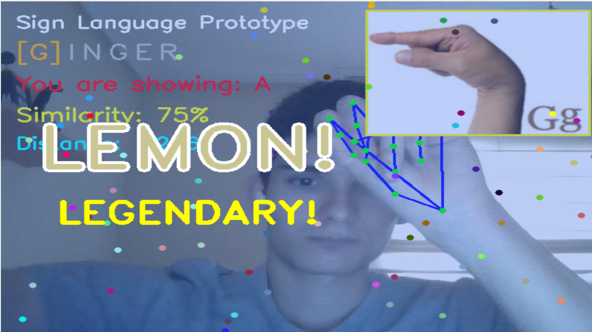

# IPM - Práctica 2 - Sign language spelling game




## Introducción

En esta práctica, hemos creado un juego para ayudar a y *gamificar* el aprendizaje del [alfabeto
tactilológico americano (ASL)](https://en.wikipedia.org/wiki/American_Sign_Language).

## Prerequisitos

Tener instalado **Conda**, [instalar aquí](https://www.anaconda.com/docs/getting-started/miniconda/install).

## Requisitos

Crear un entorno de conda:
```bash
conda create -n IPM python=3.12
conda activate IPM
```

## Instalación

Se instalan las dependencias necesarias (MediaPipe, Requests, tqdm, cv2, numpy, etc.):
```bash
pip install -r requirements.txt
```

## Estructura del proyecto
El proyecto está dividido en varios módulos para separar la lógica del juego, el
procesamiento de visión por computador y la interfaz de usuario.

```text
├── app.py
├── game/
├── vision/
├── ui/
├── models/
├── hand_references/
├── hand_guides/
├── output/
└── initial_landmark_extraction/
```

### Archivos principales
- ``app.py``: punto de entrada de la aplicación. Coordina la captura de vídeo, el
reconocimiento de gestos y la lógica del juego.

- ``download_hand_model.py``: descarga los modelos de MediaPipe necesarios para la detección de manos.

- ``extract_and_save_landmarks.py``: genera y almacena los landmarks de referencia
  utilizados por el clasificador. Carga las fotos desde `hand_references/` y los
  resultados aparecen en `output/`.

### Módulo ``game/``

Contiene la lógica del juego y la gestión de palabras.

- ``word_manager.py``: selección de palabras, banco de palabras.

### Módulo ``vision/``

Responsable del procesamiento de imagen y reconocimiento de gestos.

- ``camera.py``: inicialización de la cámara.

- ``hand_tracker.py``: detección y seguimiento de la mano mediante MediaPipe.

- ``classifier.py``: clasificación de los gestos ASL.

- ``landmark_utils.py``: funciones auxiliares para trabajar con landmarks (normalización).

### Módulo ``ui/``

Contiene los elementos visuales de la aplicación.

- ``word_ui.py``: representación de la palabra actual y progreso del usuario.

- ``guides.py``: muestra las guías visuales de los signos. Cargados desde
  `hand_guides/`.

- ``celebrations.py``: animaciones y efectos de celebración.

### Recursos
- ``hand_references/``: imágenes de referencia de cada letra del alfabeto ASL. Usadas
  para predicción.

- ``hand_guides/``: imágenes simplificadas utilizadas como guía visual durante la partida.

- ``models/``: modelos preentrenados de MediaPipe utilizados por la aplicación.

### Datos generados
- ``output/images/``: imágenes de referencia con los landmarks extraídos superpuestos.
  Para visualización/debugging.

- ``output/landmarks/``: landmarks almacenados en formato .npy para cada letra y sus
  versiones reflejadas.

### Herramientas de generación de datos
- ``initial_landmark_extraction/``: scripts empleados durante la fase inicial de creación del conjunto de referencias de landmarks utilizado por el sistema de reconocimiento.

## Descargar pesos

Script para poder descargar los pesos del modelo *Hand Landmarker*:
```bash
python download_hand_model.py
```


## Ejecución
```bash
python app.py
```

### Ejecución - WSL *passthrough*
Si estás utilizando WSL, antes de poder ejecutar `app.py` tendrás que abrir una ventana de Powershell y ejecutar:
```powershell
usbipd list
```

Identifica la entrada correspondiente a tu camara. Quédate con su `BUSID`.
A continaución, ejecuta:

```powershell
usbipd bind --busid <CAMERA_BUSID>
usbipd attach --wsl --busid <CAMERA_BUSID>
```